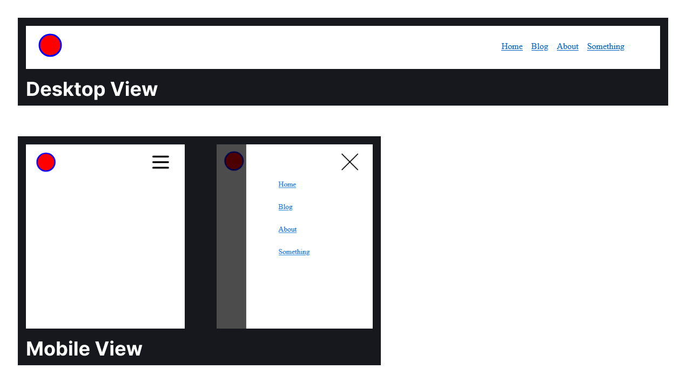

import { Tabs, TabItem } from '@astrojs/starlight/components';

How to build a responsive navigation bar using HTML, CSS and JavaScript.

On larger screens the links sit beside the logo. Below `48rem` they move into a panel opened by a hamburger button. Without JavaScript, the links stay visible.



You can Tab through the links and continue into the page. Leaving the navigation closes it. This is called [disclosure navigation](https://www.w3.org/WAI/ARIA/apg/patterns/disclosure/examples/disclosure-navigation-hybrid/).

My original CodePen example:

<iframe height="500" style="width: 100%; height: 500px;" title="Original responsive navigation example on CodePen" src="https://codepen.io/BryanHogan/embed/ByBWYab?default-tab=html%2Cresult" loading="lazy" allowfullscreen>
  See the <a href="https://codepen.io/BryanHogan/pen/ByBWYab">original responsive navigation example</a> by Bryan Hogan on CodePen.
</iframe>

The code below adds keyboard controls and focus handling to this example. These changes aren't in the CodePen yet.

## HTML, CSS and JavaScript

Load the JavaScript with `<script src="navigation.js" defer></script>` or place it before the closing `</body>` tag. It needs the HTML to be there first.

<Tabs>
<TabItem label="HTML">

The header contains a logo, a button and a list of links. The `<nav>` is named "Primary" for screen readers.

On the button, `aria-controls` points to the navigation's ID. `aria-expanded` tells screen readers whether it's open. JavaScript changes this value; CSS uses it to show the panel and swap icons. `type="button"` prevents accidental form submissions.

The hidden "Menu" text names the button. The icons have `aria-hidden="true"` so screen readers skip them. Change "Example home" to your site's name and update the logo and links.

```html
<header class="site-header">
  <a href="/" class="logo-icon" aria-label="Example home">
    <svg width="50" height="50" viewBox="0 0 50 50"
      xmlns="http://www.w3.org/2000/svg" aria-hidden="true" focusable="false">
      <circle r="20" cx="25" cy="25" stroke="blue" stroke-width="3" fill="red" />
    </svg>
  </a>

  <button type="button" aria-controls="primary-navigation"
    aria-expanded="false" class="menu-toggle-button">
    <span class="visually-hidden">Menu</span>
    <svg class="hamburger-icon" width="32" height="32" viewBox="0 0 24 24"
      xmlns="http://www.w3.org/2000/svg" fill="none" stroke="currentColor"
      stroke-width="2" stroke-linecap="round" aria-hidden="true" focusable="false">
      <path d="M4 6h16M4 12h16M4 18h16" />
    </svg>
    <svg class="close-icon" width="32" height="32" viewBox="0 0 24 24"
      xmlns="http://www.w3.org/2000/svg" fill="none" stroke="currentColor"
      stroke-width="2" stroke-linecap="round" aria-hidden="true" focusable="false">
      <path d="m6 6 12 12M6 18 18 6" />
    </svg>
  </button>

  <nav id="primary-navigation" class="primary-navigation" aria-label="Primary">
    <ul role="list">
      <li><a href="/" aria-current="page">Home</a></li>
      <li><a href="/blog/">Blog</a></li>
      <li><a href="/about/">About</a></li>
      <li><a href="/contact/">Contact</a></li>
    </ul>
  </nav>
</header>
```

Keep the button before the navigation, inside the same header. The CSS sibling selector (`~`) depends on that order. The `primary-navigation` ID must be unique on the page.

</TabItem>
<TabItem label="CSS">

I start with visible links, then add the mobile menu in a media query. JavaScript adds `data-navigation-ready` after setting up the menu controls. Until then, CSS leaves the links visible.

Use classes for the navbar styles. A bare `ul { display: none; }` would hide every unordered list on the page.

```css
.site-header,
.site-header * {
  box-sizing: border-box;
}

.site-header {
  --navigation-background: #fff;
  --navigation-text: #171717;
  --navigation-accent: #174ea6;
  display: flex;
  flex-wrap: wrap;
  align-items: center;
  justify-content: space-between;
  gap: 1rem;
  max-width: 1100px;
  margin-inline: auto;
  padding: 1rem;
  color: var(--navigation-text);
  background: var(--navigation-background);
}

.site-header .logo-icon {
  display: inline-flex;
}

.primary-navigation ul {
  display: flex;
  flex-wrap: wrap;
  gap: 0.5rem;
  list-style: none;
  margin: 0;
  padding: 0;
}

.primary-navigation a {
  display: block;
  padding: 0.75rem;
  color: inherit;
  text-decoration: none;
}

.primary-navigation a:hover,
.primary-navigation a[aria-current="page"] {
  text-decoration: underline;
  text-underline-offset: 0.25em;
}

.site-header a:focus-visible,
.site-header button:focus-visible {
  outline: 3px solid var(--navigation-accent);
  outline-offset: 3px;
}

.site-header .menu-toggle-button {
  display: none;
  align-items: center;
  justify-content: center;
  padding: 0.5rem;
  border: 0;
  border-radius: 0.25rem;
  color: inherit;
  background: var(--navigation-background);
  cursor: pointer;
}

.site-header .close-icon {
  display: none;
}

@media (width < 48rem) {
  .site-header[data-navigation-ready] .menu-toggle-button {
    display: inline-flex;
  }

  .site-header[data-navigation-ready] .primary-navigation {
    display: none;
  }

  .site-header .menu-toggle-button[aria-expanded="true"] {
    position: fixed;
    top: 1rem;
    right: 1rem;
    z-index: 30;
  }

  .site-header .menu-toggle-button[aria-expanded="true"] .hamburger-icon {
    display: none;
  }

  .site-header .menu-toggle-button[aria-expanded="true"] .close-icon {
    display: block;
  }

  .site-header[data-navigation-ready] .menu-toggle-button[aria-expanded="true"] ~ .primary-navigation {
    display: block;
    position: fixed;
    inset: 0 0 0 auto;
    z-index: 20;
    width: min(85%, 24rem);
    padding: 6rem 1.5rem 2rem;
    overflow-y: auto;
    background: var(--navigation-background);
    box-shadow: 0 0 0 100vmax hsl(0 0 0 / 0.7);
  }

  .site-header .primary-navigation ul {
    flex-direction: column;
  }
}

.visually-hidden {
  position: absolute;
  inline-size: 1px;
  block-size: 1px;
  padding: 0;
  margin: -1px;
  overflow: hidden;
  clip-path: inset(50%);
  white-space: nowrap;
  border: 0;
}
```

The fixed panel fills the screen height. `overflow-y: auto` makes it scroll on short screens. The button's higher `z-index` keeps it above the panel.

The box shadow darkens the page but doesn't block clicks. Clicking outside still activates whatever is underneath and closes the menu. Keep the header outside wrappers with `transform` or clipping, which can affect the fixed panel.

Adjust the color variables for your site. I keep reusable classes like `.visually-hidden` in a separate [utility stylesheet](/css/utility-classes). The list spacing and box sizing are included here, so this example works without a [CSS reset](/css/css-reset).

</TabItem>
<TabItem label="JavaScript">

I use `aria-expanded` to track whether the menu is open. `closeNavigation()` closes it and can return focus to the button.

```javascript
const header = document.querySelector(".site-header");
const navigationToggle = header?.querySelector(".menu-toggle-button");
const navigation = header?.querySelector("#primary-navigation");

if (header && navigationToggle && navigation) {
  const desktopNavigation = window.matchMedia("(min-width: 48rem)");
  const isOpen = () =>
    navigationToggle.getAttribute("aria-expanded") === "true";

  function closeNavigation(restoreFocus = false) {
    const wasOpen = isOpen();
    navigationToggle.setAttribute("aria-expanded", "false");
    if (wasOpen && restoreFocus && !desktopNavigation.matches) {
      navigationToggle.focus();
    }
  }

  navigationToggle.addEventListener("click", () => {
    if (isOpen()) {
      closeNavigation(true);
    } else {
      navigationToggle.setAttribute("aria-expanded", "true");
      navigationToggle.focus();
    }
  });

  document.addEventListener("click", (event) => {
    const target = event.target;
    if (!(target instanceof Element) || !isOpen()) return;
    if (navigationToggle.contains(target)) return;

    if (navigation.contains(target)) {
      if (target.closest("a[href]")) closeNavigation(true);
    } else {
      closeNavigation(navigation.contains(document.activeElement));
    }
  });

  document.addEventListener("focusin", (event) => {
    if (
      event.target instanceof Node &&
      !navigationToggle.contains(event.target) &&
      !navigation.contains(event.target)
    ) {
      closeNavigation();
    }
  });

  document.addEventListener("keydown", (event) => {
    if (event.key === "Escape" && isOpen() && !desktopNavigation.matches) {
      event.preventDefault();
      closeNavigation(true);
    }
  });

  desktopNavigation.addEventListener("change", () => {
    closeNavigation();

    if (desktopNavigation.matches && document.activeElement === navigationToggle) {
      navigation.querySelector("a[href]")?.focus();
    } else if (!desktopNavigation.matches && navigation.contains(document.activeElement)) {
      navigationToggle.focus();
    }
  });

  header.setAttribute("data-navigation-ready", "");
}
```

Opening the menu keeps focus on the button. Tab moves into the links. Escape closes it and returns focus to the button. Clicking a link closes it too, then follows the link.

When you Tab or click another control outside the menu, focus stays there. If you click plain page content while a link has focus, focus returns to the button so it doesn't get left in the hidden panel.

`matchMedia()` resets the menu when switching between desktop and mobile. It also moves focus if the resize hides the focused element. Use the same breakpoint in CSS and JavaScript: `48rem` here.

</TabItem>
</Tabs>

## The current page

Set [`aria-current="page"`](https://developer.mozilla.org/en-US/docs/Web/Accessibility/ARIA/Reference/Attributes/aria-current) on the current page's link. The CSS underlines it, and screen readers announce it.

Match the path exactly. On `/blog/my-post/`, the `/blog/` link isn't the current page. Use a separate class if you also want to style the active section.

## Using it in Astro

You can find my Astro version in [HeaderNavigation.astro](https://github.com/BryanHogan/astro-starter-template/blob/master/src/components/HeaderNavigation.astro), part of my [Astro starter](https://starter.bryanhogan.com/).

In Astro, the HTML, CSS and JavaScript can all live in one `.astro` file. The CSS goes inside `<style>` and the JavaScript inside `<script>`.

Astro keeps the CSS of a component separate, so it doesn't change the styling of other components. With plain HTML, use the classes shown above to keep the navbar styles separate.

In my starter, the link names and URLs are in a shared config file. This lets me change the links without editing the header component.

If your project uses Astro's `<ClientRouter />`, start with the complete header component from my starter. It also handles moving between pages without a full page reload.

The starter's header stays visible while scrolling. If you add `position: fixed` to your header, leave space above the page content equal to the header's height. Otherwise, the header covers the start of the page. For links to sections on the same page, `scroll-padding-top` on the scrolling element leaves room for the header when jumping to a section.

## Testing it

Test it on a page with content after the header:

- Use Enter or Space to open the menu, then Tab through the links. Escape should close it and return focus to the button. Tabbing out should close it and let focus continue into the page.
- Click a link, the close button and the area outside. Links should still follow their destinations.
- Resize across `48rem`, increase browser zoom and try a short screen with long link labels. Focus should stay visible and every link should be reachable.
- Disable JavaScript and reload. The links should stay visible and the button should be hidden.
- With a screen reader, check the button's name and expanded state, the Primary navigation landmark and the current-page link.

<details>
<summary>Sources and references</summary>

- [Disclosure navigation example - WAI](https://www.w3.org/WAI/ARIA/apg/patterns/disclosure/examples/disclosure-navigation-hybrid/)
- [The `aria-current` attribute - MDN](https://developer.mozilla.org/en-US/docs/Web/Accessibility/ARIA/Reference/Attributes/aria-current)
- [Astro starter header component](https://github.com/BryanHogan/astro-starter-template/blob/master/src/components/HeaderNavigation.astro)
- [Building a responsive navbar - Kevin Powell](https://youtu.be/HbBMp6yUXO0)
- [Building a header for an Astro blog - Kevin Powell](https://youtu.be/Thudicbgqtg?t=1941)

</details>
